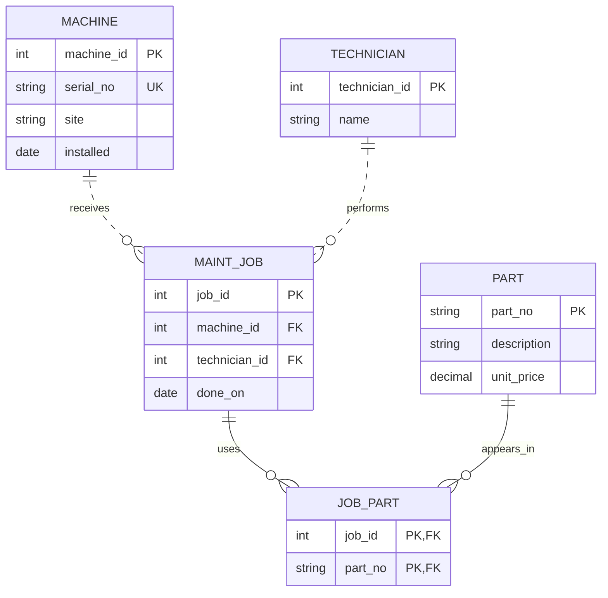

# Legacy ER audit

## Entity inventory and key decisions

| Entity | Legacy attributes | Intended identity and corrected design |
|---|---|---|
| Machine | machine_name, serial_no, site, installed | Legacy name is an informal reference; serial_no is a candidate natural key. Use machine_id surrogate PK and retain serial_no UNIQUE. Site and installation date are attributes. |
| Part | part_no, description, unit_price | part_no is a stable catalogue natural key; make it a PK. The actual fixture contains a duplicate, so the current column is not a key. |
| MaintenanceJob | job_id, machine_name, technician, done_on, parts_used | job_id surrogate PK; replace machine name with machine_id FK and technician text with technician_id FK; done_on is an attribute. |
| Technician | Embedded as maint_job.technician | Introduce technician_id surrogate PK and name. Names alone do not establish distinct people and should not be UNIQUE. |
| JobPart | Hidden in comma-separated parts_used | Composite PK (job_id, part_no), both FKs. One association per pair. |

The first three are physical tables without declared keys. The latter two reconstruct entities/relationships hidden in text. Machine names may change; the proposed exercise contract retains the serial as the business identifier and omits the informal machine_name. A real migration must preserve aliases if users need them. Part codes are assumed stable; changing that assumption may justify a surrogate part ID too.

## Proposed model (not constraints present in the legacy schema)

Each job has exactly one machine and one technician; each can have zero or many jobs. Jobs and parts have a many-to-many relationship resolved by JobPart. A job can use zero parts. The separate Technician table extends the workbook's sample implementation to match its conceptual model.

[Rendered PNG](pictures/corrected-er.png) · [Mermaid source](pictures/corrected-er.mmd)

## Measured cardinality

[Queries](cardinality-audit.sql) · [Actual results](cardinality-results.txt)

- machine = 4 rows, part = 4 rows (3 distinct part numbers), maint_job = 4 rows.
- cnc-01 has 2 jobs, cnc-02 has 1; cnc-05 has 1 but has no machine parent.
- There are 3 distinct technician strings. This alone cannot prove there are exactly 3 people.
- Jobs 1, 2, 3, 4 list 2, 1, 1, 0 parts respectively.
- P-1001 occurs in 2 different jobs; P-1002 and P-1003 each occur in 1 job. Both sides show multiplicity, supporting a hidden m:n association.
- The workbook's LENGTH expression yields NULL for job 4, not zero. The saved CASE variant handles NULL/empty lists explicitly. The splitting query is for this controlled fixture, not arbitrary CSV with escaping.

**1:1:** no separate 1:1 relationship is evidenced in the legacy schema. **1:n:** jobs intend to reference machines and technicians, but text columns do not enforce it. **m:n:** job-to-part links are hidden inside parts_used and need a junction table.

Counts demonstrate observed multiplicity and expose contradictions; they cannot establish every future maximum or mandatory participation rule. Those require business requirements.
