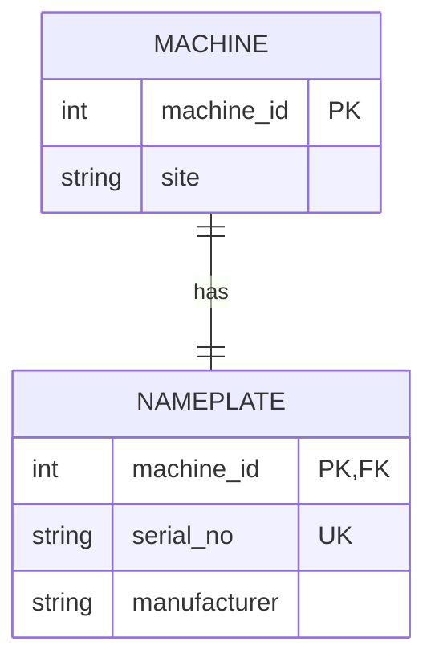
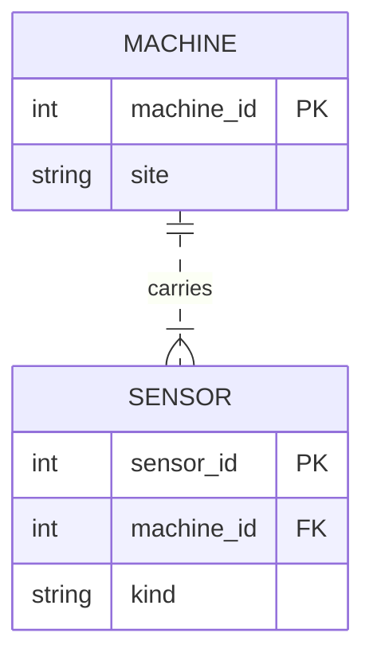
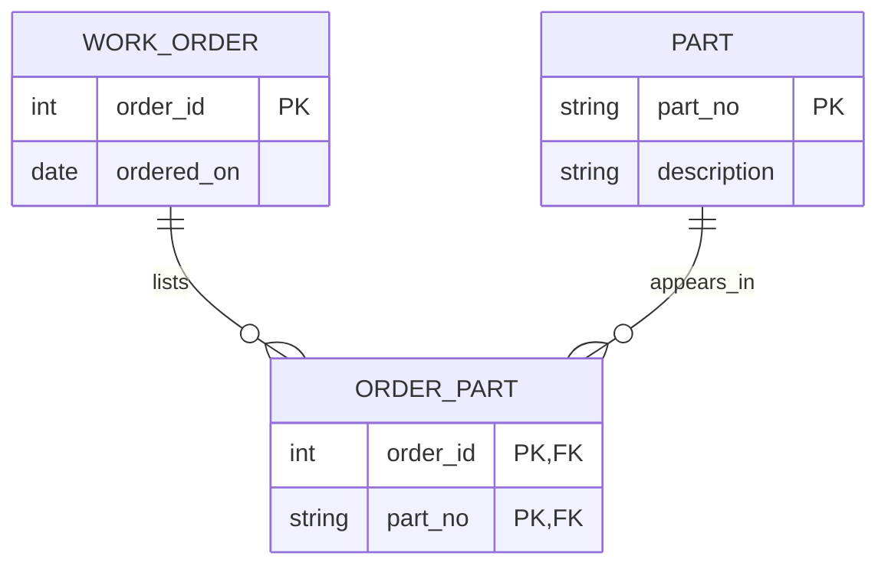
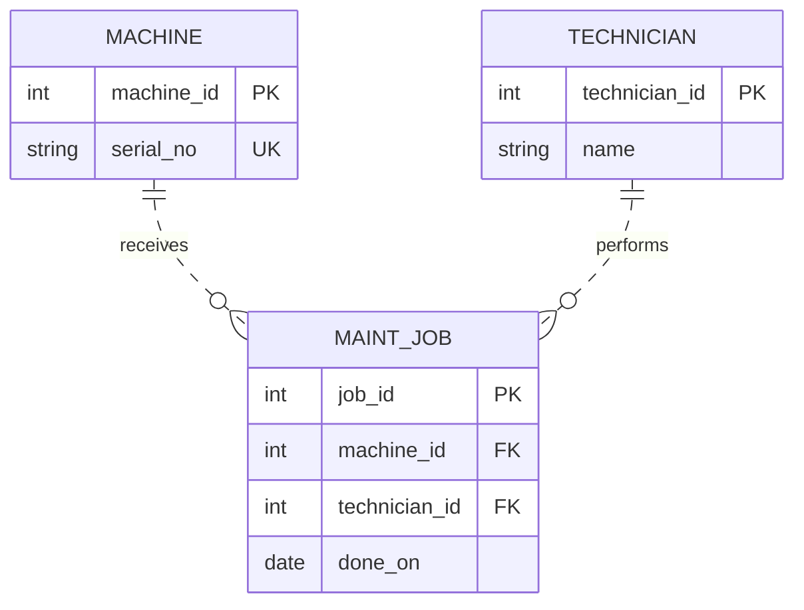

# Four ER sketches — Task B

Prepared with AI assistance for Tunay to review and explain. PK = primary key; FK = foreign key; UK = unique key. Solid lines indicate identifying relationships (parent key is part of child identity); dashed lines indicate non-identifying relationships. A diagram can express a business requirement stronger than its SQL implementation.

## 1:1 — machine and nameplate

The shared primary/foreign key allows at most one nameplate per machine and requires an existing machine for each nameplate. It does NOT force every machine to have a nameplate: the exact-one requirement needs a transaction/workflow or a different design. If the nameplate has no independent lifecycle, serial and manufacturer can simply be attributes of Machine. The drawing states the business requirement, not a guarantee provided by the FK alone.

## 1:n — machine and sensors

The foreign key belongs to Sensor, the many side, and is NOT NULL. This drawing interprets “each machine carries many sensors” as one or more. A foreign key alone permits a machine with zero sensors; minimum participation requires a workflow. Two sensor rows sharing machine_id demonstrate multiple children, not a universal upper bound. [Executable proof](sketch-proof.sql) and [actual output](sketch-proof-results.txt) show two sensors for machine 1 and rejection of an orphan.

## m:n — work orders and parts

OrderPart is the junction entity. The composite primary key (order_id, part_no) prevents a given part appearing twice in one order. Each foreign key references its parent. Zero links are allowed while drafting an order; if the business requires at least one, finalization must check that. The contract uses this same pattern for maintenance jobs and parts.

## Job — entity, attribute, and relationship

A job is an event entity: it has identity and a date and can later carry duration or notes. It connects one machine and one technician. The date is an attribute. Technician is an entity because identity must survive spelling/name changes; different people can share a name. This design assumes one technician per job, as in the exercise. Multiple technicians would require another junction table.
