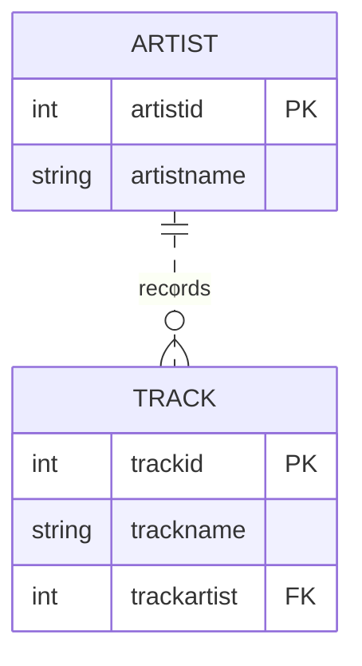
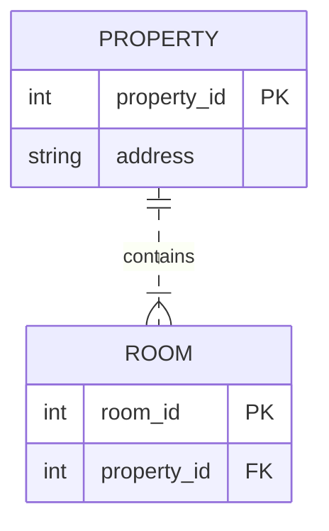

# Module 2 study preparation

**Status:** AI-prepared reference notes and verified technical examples. They are not a record of Tunay having studied, searched, met a pod or posted in Discord. Personal entries below remain pending.

## References consulted during preparation

| Source | Concept illustrated |
|---|---|
| [Professor's Module 2 workbook](https://github.com/iotempire/iotempire-teaching/blob/main/full-classes/hsbi-databases-10d/modules/02-data-contracts-and-legacy-schemas.md) | Reconstruct intended relationships from broken maintenance data; content below its draft boundary is provisional |
| [SQLite foreign keys](https://www.sqlite.org/foreignkeys.html) | Child-to-parent checks, NULL optionality and connection-level enforcement |
| [Mermaid ER diagrams](https://mermaid.js.org/syntax/entityRelationshipDiagram.html) | Crow's-foot minimum/maximum participation and PK/FK notation |
| [Pydantic validators](https://docs.pydantic.dev/latest/concepts/validators/) | Field validation and custom rules before persistence |
| [SQLAlchemy SQLite dialect](https://docs.sqlalchemy.org/en/20/dialects/sqlite.html) | SQLite constraints and enabling foreign keys on connection |

## Research questions and verified answers

These are preparation questions, not a fabricated personal search history.

- **Where does the FK go in 1:n?** On the child/many side. SQLite's artist/track example and [the sensor proof](sketch-proof-results.txt) show multiple children referencing one parent.
- **Does a natural key become a key merely by being named part_no?** No. P-1003 occurs twice; the proposed PK rejects duplicates. See [audit](integrity-results.txt) and [tests](test-results.txt).
- **Does a numeric declaration enforce money rules in SQLite?** No. Numeric affinity is not a complete financial contract; explicit checks and Decimal validation are used. See [business rules](business-rules.md).
- **Is a job just a relationship?** It is useful as an event entity with its own ID and date. It links Machine and Technician and participates in JobPart.
- **What does EER add?** Generalization/specialization, such as Machine with CNC and injection-molder subtypes. Disjoint means an instance cannot belong to both; complete means every parent belongs to a subtype. Ordinary ER/FK diagrams alone do not prove either condition.

## Remarkable technical findings to discuss

The naive part join both drops job 1 and duplicates job 2. A date-shaped string can be invalid. A count of three names is not proof of three distinct people. A mandatory child FK does not force a parent to have children. These are verified/modeling observations, not claimed personal reactions.

## LLM Q&A and verification

The following requests are taken from the supplied master prompt and answered in this implementation; no separate external LLM conversation is claimed.

| Prompt/request | Answer summary | Verification and limits |
|---|---|---|
| Distinguish a database rule of “at most one” from the business requirement “exactly one.” | A shared child PK/FK limits children to one but does not require a child for each parent. | Review the nameplate key placement in [four examples](er-examples.md); do not overclaim FK coverage. |
| Also document how duplicate parts can produce duplicated join results. | Both P-1003 rows match job 2, so the result contains it twice. | Actual [integrity results](integrity-results.txt). |
| Be careful with SQLite type affinity: declaring a column NUMERIC alone does not guarantee every inserted value has correct money semantics. | Use Decimal input validation and explicit database checks; exact arithmetic needs a stronger representation. | Negative, text and fractional-cent insertion tests; documented floating-point limitation. |

## Two sourced example redraws

### 1. Artist and Track — SQLite example

Source: [SQLite foreign-key documentation, introductory artist/track example](https://www.sqlite.org/foreignkeys.html). This is an original redraw of the source schema. The required parent below is an explicit adaptation: SQLite's initial nullable trackartist example allows an absent artist; adding NOT NULL changes it to exactly one for each track.

My takeaway: I connected this example to a music platform like Spotify. It shows how an artist is linked to multiple tracks through an ID. At first, I also thought it represented albums, but there is no Album entity in this diagram. This helped me distinguish what a model actually includes from what I assume about the application.

### 2. Property and Room — Mermaid example

Source: [Mermaid ER documentation](https://mermaid.js.org/syntax/entityRelationshipDiagram.html), PROPERTY/ROOM example. The IDs and address shown here are illustrative additions to make key placement explicit.

My comparison with the first example: This initially reminded me of a property website like Sahibinden. However, the diagram describes properties and their rooms, rather than listings or searches. Like Artist–Track, it uses a one-to-many relationship: one property contains multiple rooms, and each room belongs to one property. I also learned that a foreign key links a room to an existing property, but does not by itself guarantee that every property has a room recorded.

## Task B — four own examples and proof

See [er-examples.md](er-examples.md), [SQL proof](sketch-proof.sql) and [executed proof](sketch-proof-results.txt). Review the difference between intended requirements and enforced constraints before explaining the diagrams.

## Task A — personal study record

This module helped me understand why software needs clear instructions and explicit rules. The most challenging part was translating an everyday idea into precise database constraints.

I ran the audit and all 25 automated tests on my Windows computer, followed by the optional EER checks. All completed successfully. I used the prepared module materials and ChatGPT's explanations to support my work.

I also had a brief discussion with İsa Babayev about the module. We shared similar impressions about the difficulty of expressing instructions clearly, but we did not review every query or diagram together.

I reviewed both sourced ER examples and added my takeaways above. The neighboring-pod discussion and Discord image share are still pending.

## Agreed learning (pod discussion)

Participants: Tunay Daldaban and İsa Babayev.

We discussed how diagrams help us understand the connections within a system. We initially compared them to a machine that guides us towards an output. After further clarification, I understood that an ER diagram describes relationships between data rather than the sequence of steps used to produce an output.

Our discussion covered these points:

- Diagrams help make the connections within a system easier to understand.
- The same modeling approach can describe different domains, such as students and teachers or machines and sensors.
- A model can become more detailed as the system and its requirements become more complex.

This records our discussion within our own pod. A discussion with a neighboring pod has not yet been documented.

## Task C — shared image

I shared a simple Machine–Sensor ER diagram in the class Discord channel.

The diagram illustrates a one-to-many relationship: one machine can carry several sensors, while each sensor belongs to one machine. It connects the modeling concepts to an engineering example.

[Discord post](https://discord.com/channels/1064132619735928932/1560197797364502559/1562617893227733102)

The image-sharing part is complete. The neighboring-pod discussion remains pending.