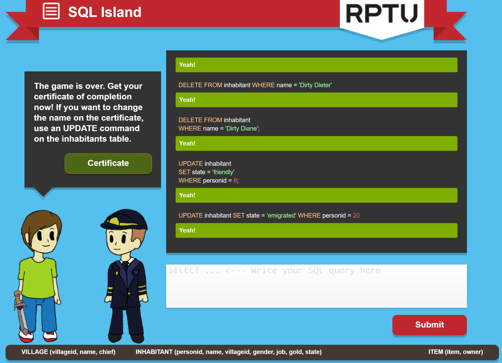

# SQL Island — Personal Reflection

Status: completed.

## 1. What did you learn from the game?

The interface and gameplay reminded me of games I usually play. Instead of using movement keys or a controller, I used SQL commands to interact with the game. This helped me see how commands can change stored data and affect what happens in a game. Regular games use more complex systems, but this connection made SQL more interesting to me.

## 2. Which commands did you actually use?

I used SELECT, WHERE, AND, OR, LIKE, JOIN, ORDER BY, GROUP BY, UPDATE and DELETE, as well as COUNT, SUM and AVG.

For example, I used this query to find friendly inhabitants with a job ending in "smith":

```sql
SELECT *
FROM inhabitant
WHERE state = 'friendly'
  AND job LIKE '%smith';
```

## 3. What are a table, row, column and query?

A table stores related information, such as the inhabitants.
A row represents one record, such as one inhabitant.
A column stores one type of information, such as a name, job or gold amount.
A query is a request to the database, for example to find inhabitants with a specific job.

## 4. What surprised you, and what is still confusing?

What stood out to me was how similar this felt to a regular game, even though I controlled it through SQL. I found this way of learning useful and enjoyable.

The hardest part was combining commands and conditions and thinking about the different ways to write a query. I still need more practice with this.

## AI assistance

I used ChatGPT to help formulate SQL queries and explain commands. I ran the queries myself in the game. The personal reflections above are based on my own experience.

## Completion certificate

[SQL Island certificate](Certificate_SQL-Island.pdf)

## Game completion screenshot

